<p align="center">
  
</p>

<p align="center">
  <a href="README.md">中文</a> ·
  <a href="#key-capabilities">Capabilities</a> ·
  <a href="#three-branch-architecture">Architecture</a> ·
  <a href="#quick-start">Quick Start</a> ·
  <a href="#license">License</a>
</p>

<br />

**PPEELink** is a self-hosted proxy node, dual-agent probe, and smart subscription panel built with Go and Vue 3.

It brings VPS Xray-core inbound management, native unlock-driven smart subscription routing, client-side dual-channel network diagnostics with Clash/Mihomo integration, and multi-card fleet management into one calm, single-binary interface.

<br />

## Key Capabilities

| Area | Overview |
| :--- | :--- |
| **Self-Hosted Inbounds** | Manages Xray-core via the standalone Server Agent across 10 inbound templates (VLESS Reality Vision / XHTTP / gRPC / WS+TLS, VMess, Trojan, Shadowsocks 2022, Hysteria2), with keyless auto-TLS, VPS-side Reality SNI audits, BBR tuning, and one-click fleet updates. |
| **Native Unlock Matrix & Smart Routing** | Server Agents test native VPS egress for ChatGPT, Claude, Gemini, Netflix, Disney+, YouTube, TikTok, and Spotify, rendered directly on host cards. Clash subscriptions (including `proxy-providers` mode) dynamically rewrite AI/streaming group filters from verified results, with a live preview card on the Subscriptions page. |
| **User Agent Dual-Channel Diagnostics** | On-demand client probe (Windows / macOS / Linux) separating physical-NIC direct traffic (bypassing Clash TUN / Fake-IP) from active proxy traffic for 5s real throughput + retention testing, CORS-free unlock checks, and bidirectional traceroutes. |
| **Clash / Mihomo Control** | Connects to local Clash External Controller (with API secret auth & inline drawer setup) to switch nodes or run automated full-node speed + unlock matrix sweeps with automatic node restoration. |
| **Fleet Management & Privacy** | Low-density multi-card drawers for both Server and User Agents: batch silent upgrades, pre-flight verified panel URL migration (preventing accidental fleet lock-out), host-enforced capability policies (WebShell / Files / Docker / Firewall / Auto-Update), and client privacy/concurrency controls. |
| **Security & Live Topology** | Interactive world map with live user-to-node arcs and anomaly pills, VPS inbound scan auditing with `iptables` ban/unban, JWT logout revocation, login rate limiting, and SQLite WAL tuning. |

<br />

## Three-Branch Architecture

| Branch | Role | Deployment Path |
| :--- | :--- | :--- |
| **`main`** | Control panel (Go 1.25 + Gin + GORM + SQLite WAL + embedded Vue 3 SPA) | `ppeelink` binary |
| **`agent`** | Remote Server Agent (`v1.24`, standalone Go module for `linux/amd64`, `arm64`, `armv7`) | `downloads/agent/` |
| **`userAgent`** | Client-side User Agent (`v1.10`, standalone Go module for Windows / macOS / Linux with tray) | `downloads/user-agent/` |

<br />

## Quick Start

Requires Go 1.25+ and Node.js 20+ (`pnpm`):

```bash
# 1. Build frontend
cd webs && pnpm install && pnpm build && cd ..

# 2. Build panel binary (with_utls & with_quic required)
go build -tags "with_utls with_quic" -ldflags="-w -s" -o ppeelink .

# 3. Run (default port 8000, default login admin / 123456)
./ppeelink
```

To enable one-click Agent installation and remote upgrades, run `./build.sh` on the `agent` and `userAgent` branches and place the generated `dist/` files into `downloads/agent/` and `downloads/user-agent/` respectively.

<br />

## License

[MIT](LICENSE)
