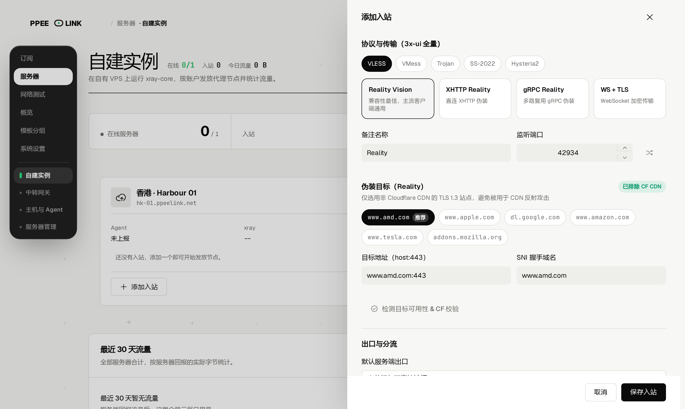
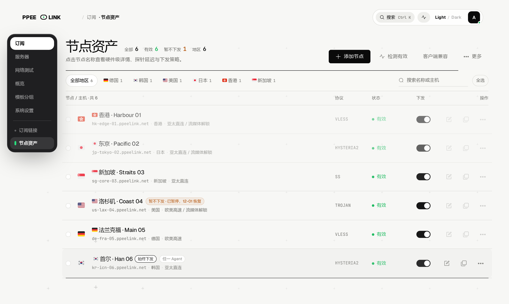
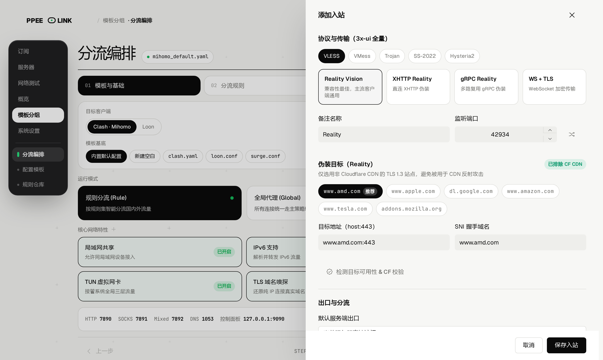
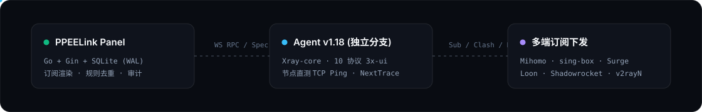

<p align="center">
  
</p>

<p align="center">
  <a href="README.en-US.md">English</a> ·
  <a href="#界面预览">界面预览</a> ·
  <a href="#快速开始">快速开始</a> ·
  <a href="#架构">架构</a>
</p>

<br />

**PPEELink** 是一个用 Go 和 Vue 3 写的自建代理节点与订阅管理面板。

它把日常用到的几件事收拢进一个干净的界面里：多台 VPS 上的 3x-ui 协议入站管理、按国家/地区整理的节点订阅分发、分流模板可视化编排，以及基于远程 Agent 的真实网络探测（国内 TCP Ping、NextTrace 路由追踪、双端吞吐互测）。

<br />

## 界面预览

<p align="center">
  
</p>

<table>
  <tr>
    <td width="50%">
      
      <p align="center"><sub>自建实例与 10 种 3x-ui 入站协议（默认排除 CF CDN 伪装目标）</sub></p>
    </td>
    <td width="50%">
      
      <p align="center"><sub>按国家 / 地区自动归类节点与多视角 Agent 可达性判定</sub></p>
    </td>
  </tr>
  <tr>
    <td colspan="2">
      
      <p align="center"><sub>四步单屏分流模板编排（Clash / Mihomo · Surge · Loon）</sub></p>
    </td>
  </tr>
</table>

<br />

## 主要能力

| 模块 | 说明 |
| :--- | :--- |
| **自建节点与 3x-ui 协议** | 通过独立 Agent 管理 Xray-core，支持 VLESS（Reality Vision / XHTTP / gRPC / WS+TLS）、VMess（WS+TLS / TCP）、Trojan（Reality / TLS）、Shadowsocks 2022 与 Hysteria2。TLS 类协议支持免域名自动证书；Reality 自动拦截 Cloudflare CDN 目标。 |
| **订阅与国家归类** | 节点按国家/地区自动分组，订阅按地区一键勾选并支持正则过滤、重命名、去重、国旗补齐与多端格式输出。 |
| **模板与规则仓库** | 四步单屏模板编排器；内置上游规则同步，自动按标准化规则数量与内容指纹去重。 |
| **多视角网络探测** | 国内 TCP Ping 支持由节点本机 Agent 直测真实延迟；NextTrace 追踪支持同 IP 合并与地图逐跳飞跃回放；支持双端互斥单选吞吐互测。 |
| **安全与运行** | JWT 登出即刻吊销、单 IP 登录防爆破、公开订阅令牌桶限流、SQLite WAL 调优与 `SIGTERM` 优雅停机。 |

<br />

## 架构

<p align="center">
  
</p>

- **主面板（`main` 分支）**：Go 1.25 + Gin + GORM + SQLite（WAL），前端静态资源编译后直接嵌入单一可执行文件。
- **独立 Agent（`agent` 分支）**：独立 Go 模块，交叉编译 `linux/amd64`、`linux/arm64`、`linux/armv7` 产物后放入面板 `downloads/agent/` 目录，由面板下发配置并通过反向 WebSocket 承载终端、文件、Docker 与节点直测 RPC。

<br />

## 快速开始

### 从源码构建

需要 Go 1.25+ 与 Node.js 20+（pnpm）：

```bash
# 1. 构建前端
cd webs
pnpm install
pnpm build
cd ..

# 2. 编译面板（需开启 with_utls 与 with_quic 以支持完整协议探测）
go build -tags "with_utls with_quic" -ldflags="-w -s" -o ppeelink .

# 3. 启动（默认监听 8000 端口，默认账号 admin / 123456，首次登录需改密）
./ppeelink
```

修改端口或重置密码：

```bash
./ppeelink run -port 8001
./ppeelink setting -username admin -password 新密码
```

### 发布 Agent 产物

在 `agent` 分支执行 `./build.sh`，将生成的 `dist/` 目录内容复制到面板运行目录的 `downloads/agent/` 下即可支持一键安装与在线升级。

<br />

## License

[MIT](LICENSE)
