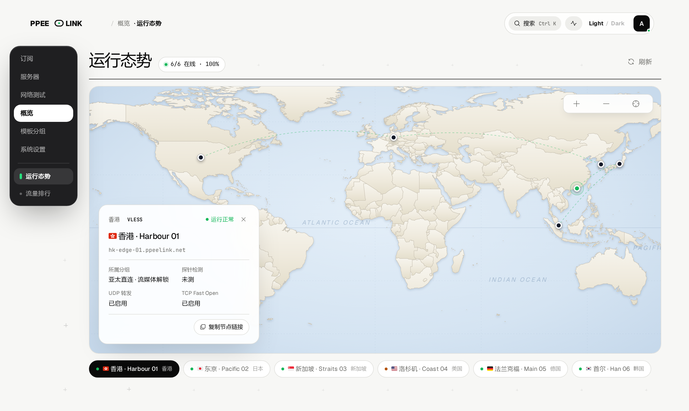

<p align="center">
  
</p>

<p align="center">
  <a href="README.en-US.md">English</a> ·
  <a href="#界面预览">界面预览</a> ·
  <a href="#核心能力">核心能力</a> ·
  <a href="#三分支架构">架构</a> ·
  <a href="#快速开始">快速开始</a> ·
  <a href="#致-ai-开发者">致 AI 开发者</a>
</p>

<br />

**PPEELink** 是一款基于 Go 与 Vue 3 构建的自建代理节点、双端 Agent 探针与智能订阅管理面板。

它将多台 VPS 的 Xray-core 入站管理、原生解锁矩阵与订阅智能分流、本机用户侧双通道真测速与 Clash 联动、以及低密度多卡片的 Agent 车队管理收拢进同一套克制、清晰的界面里。

<br />

## 界面预览

<p align="center">
  
</p>

<table>
  <tr>
    <td width="50%">
      
      <p align="center"><sub>自建实例与 10 种 Xray 入站协议（含 Reality SNI VPS 侧实测体检）</sub></p>
    </td>
    <td width="50%">
      
      <p align="center"><sub>按国家 / 地区自动归类节点与多视角真实可达性监测</sub></p>
    </td>
  </tr>
  <tr>
    <td colspan="2">
      
      <p align="center"><sub>四步分流模板编排（Clash / Mihomo · Surge · Loon）</sub></p>
    </td>
  </tr>
</table>

<br />

## 核心能力

| 模块 | 说明 |
| :--- | :--- |
| **自建实例与入站管理** | 通过独立 Server Agent 管理 Xray-core，支持 VLESS（Reality Vision / XHTTP / gRPC / WS+TLS）、VMess（WS+TLS / TCP）、Trojan（Reality / TLS）、Shadowsocks 2022 与 Hysteria2。支持免域名自动证书、Reality SNI VPS 侧实测评分、一键批量升级全部节点与内核 BBR 调优。 |
| **原生解锁矩阵与智能分流** | Server Agent 原生检测每台落地机对 ChatGPT、Claude、Gemini、Netflix、Disney+、YouTube、TikTok、Spotify 的真实解锁状态，在「主机与 Agent」及「自建实例」卡片直显；Clash 订阅（含 `proxy-providers` 模式）自动按实测结果动态重写 AI / 流媒体策略组过滤规则，并在「订阅链接」页实时可视化展示纳入与剔除清单。 |
| **用户 Agent 双通道实测** | 运行在用户本机（Windows / macOS / Linux），按需触发、零后台滥用。区分「物理网卡直连（绕过 Clash TUN / Fake-IP）」与「当前代理出口」双通道，提供 5 秒真实带宽与衰减比测速、无 CORS 原生 AI / 流媒体解锁、以及「本机去程 + VPS 回程」双向路由追踪。 |
| **Clash / Mihomo 联动控制** | 支持连接本机 Clash 外部控制接口（含 API 密钥校验与内嵌连接配置），实时切换策略组节点，或一键自动轮切全节点完成真实带宽与解锁矩阵测速并自动恢复原节点。 |
| **Agent 车队集中管理** | Server Agent 与 User Agent 均提供低密度多卡片管理抽屉：一键全量静默升级、**面板域名 URL 预检迁移**（新地址连通校验通过后再切换，防止填错失联）、**安全与隐私权限控制**（主机侧硬拦截 WebShell / 文件上传 / Docker / 自动防火墙 / 远程自更新，用户侧控制公网 IP 上报、Clash 联动与探测并发数）。 |
| **安全防护与全局拓扑** | 首页写实世界地图展示用户端到端实时飞行连线与异常焦点；VPS 侧支持入站扫描审计与 `iptables` 一键封禁；面板内置 JWT 登出吊销、登录防爆破、公开订阅限流与 SQLite WAL 调优。 |

<br />

## 三分支架构

<p align="center">
  
</p>

仓库由三个职责清晰的独立分支协同组成：

| 分支 | 定位 | 产物目录 |
| :--- | :--- | :--- |
| **`main`** | 主面板（Go 1.25 + Gin + GORM + SQLite WAL + Vue 3 嵌入式单文件） | 面板可执行文件 `ppeelink` |
| **`agent`** | 远端服务器 Agent（当前 `v1.25`，独立 Go 模块，支持 `linux/amd64`、`arm64`、`armv7`） | 放入面板运行目录 `downloads/agent/` |
| **`userAgent`** | 本机用户侧探针（当前 `v1.12`，独立 Go 模块，支持 Windows / macOS / Linux，含系统托盘） | 放入面板运行目录 `downloads/user-agent/` |

<br />

## 快速开始

### 让 AI 帮你部署

可将以下指令直接发给你的 AI 编程助手（Antigravity / Claude Code / Cursor / Codex 等），按根目录 [AGENTS.md](AGENTS.md) 自动完成编译、产物部署与 systemd 托管：

```text
请帮我把 https://github.com/Xioaruan912/PPEELink 部署到我的 Linux 服务器。
请严格按照仓库根目录的 AGENTS.md「AI 协助用户部署标准流程」执行：
先询问我目标服务器的连接方式、监听端口和是否需要域名 HTTPS，再完成主面板与双端 Agent 编译、产物放置、systemd 服务配置并验证启动成功。
```

### 从源码构建

需要 Go 1.25+ 与 Node.js 20+（pnpm）：

```bash
# 1. 构建前端
cd webs
pnpm install
pnpm build
cd ..

# 2. 编译面板（需开启 with_utls 与 with_quic）
go build -tags "with_utls with_quic" -ldflags="-w -s" -o ppeelink .

# 3. 启动（默认端口 8000，默认账号 admin / 123456，首次登录需改密）
./ppeelink
```

常用运维命令：

```bash
./ppeelink run -port 8001
./ppeelink setting -username admin -password 新密码
```

### 发布双端 Agent 产物

- **Server Agent（`agent` 分支）**：运行 `./build.sh`，将 `dist/` 内三架构二进制与 `release.json` 复制到面板工作目录的 `downloads/agent/`。
- **User Agent（`userAgent` 分支）**：运行 `./build.sh`，将 `dist/` 内五平台二进制复制到面板工作目录的 `downloads/user-agent/`。

<br />

## 致 AI 开发者

接手继续开发前，请先阅读根目录 [AGENTS.md](AGENTS.md) 与 [webs/DESIGN.md](webs/DESIGN.md)：

- **设计约束**：遵循克制的石色调面板与低密度多卡片视觉语言，拒绝冗余小字与花哨装饰。
- **构建门禁**：前端先过 `vue-tsc` 再构建，后端编译必须带 `-tags "with_utls with_quic"`，发布 Agent 后务必核对 `release.json` 版本号与 SHA-256。
- **文档与分支**：`AGENTS.md` 仅允许在文末日志区追加；commit message 禁止附加 `Co-Authored-By:`；仓库仅维护 `main`、`agent`、`userAgent` 三个分支。

<br />

## License

[MIT](LICENSE)
